# Pipeline automatizado de personajes y animaciones 2D: n8n + Venice + ComfyUI

> **Fecha:** 2026-11-15 · **Estado:** investigación y arquitectura, sin cambios de código ni descargas.
> **Documento hermano:** `docs/art/investigacion-pipeline-arte-ia.md` (2026-11-11), que recomendaba recortes + rig (R3) para el estilo cartoon de este juego. Este documento estudia la otra ruta: **sprites de fotogramas generados con modelos locales**.
>
> **Etiquetas de fiabilidad.** **[L]** medido en un archivo, carpeta o API local · **[C]** leído en la API pública de Civitai (`civitai.com/api/v1/models/{id}`) · **[HF]** leído en la API de Hugging Face · **[I]** inferencia mía que hay que comprobar con una prueba.

---

> **Decisión 2026-11-16:** el destino es **Battle Cats Web, estilo cartoon** (no Unity, no pixel art). La § 7 sustituye a las §§ 2–5 donde se contradigan.

## 0. Resumen ejecutivo

1. **En `C:\Users\Usuario\Documents\Proyectos` no hay ningún proyecto de juego** [L]. Hay tres carpetas del pipeline de imagen *Sofía* (`sofia-pipeline`, `sofia-pipeline-v2`, `sofia2-workspace`). Ahí están n8n en Docker, Venice y ComfyUI, y se pueden reutilizar casi por completo. Las especificaciones de personaje y animación están en **este repo** (`battle-cats-web`, PixiJS 8, no Unity). Ver § 1.4.
2. **De los 8 recursos, 4 sirven y 4 sobran:**
   - **Base del personaje:** Retro Game Art (Illustrious) o 2D Pixel Toolkit (SD 1.5).
   - **Hoja de sprites:** Lah Animation Sheet (Qwen Edit 2509).
   - **Vídeo:** los dos LoRA de Wan 2.2 A14B (marcha y ataque).
   - **Descartados:** Kqnpixel, Dungeon Squad y Ragnarok Online imitan a un artista o a un juego concreto, y Ragnarok además está entrenado con sprites extraídos de un juego comercial. No conviene publicar un juego con ellos.
3. **Ninguno de los 8 genera *Idle* ni *Hurt*.** La **marcha** sale de Wan. El **ataque** sale de Wan o de Lah, y hay que probar los dos. **Muerte, salto y embestida** salen de Lah. **Idle y Hurt** se hacen por procedimiento: rebote o destello en el motor, o 2–3 fotogramas editados con Qwen Edit sin LoRA.
4. **El límite es la GPU:** una RTX 5060 de 8 GB con 31 GB de RAM [L].
   - Wan 2.2 A14B (dos expertos) y Qwen Image Edit 2509 (20B) **no caben en VRAM**. Corren cuantizados en GGUF, con la VRAM dinámica de ComfyUI que ya tienes activa y LoRA de 4 a 8 pasos. Funciona, pero lento: del orden de minutos por clip [I].
   - Las LoRA de Wan son **solo para A14B**. No funcionan con Wan 2.2 5B, que sí cabría.
5. **Arquitectura propuesta:** 4 flujos n8n nuevos (`S2-N10A` a `S2-N10D`), 3 workflows ComfyUI nuevos (`S2-P20A`, `S2-P21A`, `S2-P22A`) y un servicio Python en el host (`servicio_sprites`, puerto 8191). Copian los patrones que ya funcionan en Sofía: formularios de 2 páginas, `POST /prompt` → `/history` → `/view`, un registro JSON por personaje y el servicio de identidad en el puerto 8190.
   - El posproceso se hace **fuera de n8n**: el contenedor no tiene Python ni ffmpeg, y mover PNG por n8n es lento.
6. **Primero, un piloto manual:** 1 aliado y 1 enemigo, rutas Qwen y Wan comparadas en la interfaz de ComfyUI. Hay que hacerlo antes de escribir un solo flujo de n8n (§ 5, fase F0).

---

## 1. Diagnóstico del entorno local

### 1.1 Qué hay en `C:\Users\Usuario\Documents\Proyectos` [L]

| Carpeta | Qué es | Estado |
|---|---|---|
| `sofia-pipeline\` | Versión 1 del pipeline Sofía: scripts Python, tests y documentación de investigación (`ComfyUI_Architecture_V39.md`, `Video_Generation_WAN_I2V.md`, `VRAM_Optimization_Matrix.md`…) | Histórico; su investigación se copió a v2 |
| `sofia-pipeline-v2\` | **Proyecto activo.** n8n en Docker, 17 flujos exportados, 8 workflows ComfyUI con ficha, prompts de sistema para Venice, scripts que **generan** los JSON de n8n | En uso (última actualización 2026-10-30) |
| `sofia2-workspace\` | Directorio base de ComfyUI (puerto 8189): `custom_nodes`, `input`, `output`, `user` | En uso |

**No hay** proyecto Unity, especificaciones de personajes de juego, estados *Idle/Walk/Attack/Hurt* ni formato de sprites en esa carpeta.

### 1.2 n8n y Venice: cómo están montados hoy [L]

| Pieza | Configuración actual | ¿Reutilizable? |
|---|---|---|
| Contenedor | `n8nio/n8n:2.45.3` fijado por digest, `127.0.0.1:5678`, `NODE_FUNCTION_ALLOW_BUILTIN=fs,path`, `extra_hosts: host.docker.internal` (`tools\n8n\docker-compose.yml`) | Sí, añadiendo un volumen de salida de assets (§ 4.4) |
| Volúmenes | `prompts`, `workflows:ro`, `reportes`, `dataset`, `tools/config`, `referencias` montados en `/project/...` | Sí; falta uno para assets del juego |
| Llamada a ComfyUI | Desde nodos Code con `this.helpers.httpRequest`: `GET /object_info/<clase>` (rellena listas del formulario) → `POST /prompt` → sondeo de `/history/{id}` → `/view` (con vista previa webp) | **Sí, tal cual** (`scripts\n8n_generar_flujo_anime.py`) |
| Venice | Nodo HTTP con credencial *Header Auth account*, `https://api.venice.ai/api/v1`, modelo de texto `e2ee-gemma-4-26b-a4b-uncensored-p`, `include_venice_system_prompt: false`; prompts de sistema en `prompts\sistema_*.md`; la respuesta se parsea por líneas (`IDENTITY:` / `OUTFIT:`) | Sí; añadir un `sistema_sprite_ficha.md` |
| Crítico visual | Venice puntúa 0–1 y el flujo aprueba (≥ 0,70), revisa o rechaza (< 0,40) con reintentos de semilla (`S2-N01`) | Sí, para la QA de fotogramas |
| Registro de personajes | `prompts\personajes_anime.json` (identidad, modelo, LoRA, historial) | Sí, como plantilla de `personajes_sprite.json` |
| Generación de flujos | Los JSON de n8n se **generan** con Python (`n8n_generar_flujo_*.py`) y se importan con `n8n import:workflow` (hay que conservar el `id` para no duplicar) | Sí: `n8n_generar_flujo_sprites.py` |
| Servicio auxiliar en el host | `scripts\servicio_identidad.py`, puerto 8190, al que n8n llama por HTTP | **Patrón clave** para el posproceso de sprites |

**Workflow más cercano a lo que necesitas:** `S2-P10A-t2i-sdxl-anime-v1`. Es un texto→imagen genérico SDXL/Pony/Illustrious con una pila de LoRA que arma n8n, *clip skip* y valores por tipo de familia. Sirve para la fase A en cuanto haya un checkpoint Illustrious [L].

### 1.3 ComfyUI y hardware [L]

| Recurso | Hay | Falta para este pipeline |
|---|---|---|
| GPU / RAM | RTX 5060 **8 GB** (Blackwell, admite nvfp4) · **31 GB** RAM | — |
| Arranque | `iniciar_servidor.ps1`: ComfyUI de *Comfy Desktop* con `--base-directory sofia2-workspace` y modelos compartidos en `ComfyUI-Shared\models`; VRAM dinámica activa | — |
| Checkpoints | `juggernautXL_ragnarok` (SDXL realista) | Un checkpoint **Illustrious** y/o uno **SD 1.5** |
| Modelos de difusión | `z_image_turbo_nvfp4`, `krea2_turbo_nvfp4`, `flux-2-klein-base-4b-fp8` | **Wan 2.2 I2V A14B** (high + low) y **Qwen Image Edit 2509** |
| Codificadores de texto | `qwen_3_4b`, `qwen3vl_4b_fp8_scaled` | `umt5_xxl` (Wan) y `qwen_2.5_vl_7b` (Qwen Edit) |
| VAE | `ae`, `flux2-vae`, **`qwen_image_vae` ✓** | `wan_2.1_vae` |
| Nodos | Impact Pack y Subpack, IPAdapter Plus, InstantID, Krea2-Ostris-Edit, controlnet_aux | **ComfyUI-GGUF** (cargar GGUF), **VideoHelperSuite** (opcional, vista previa); opcional quitar fondo (BiRefNet/RMBG) y nunchaku |

### 1.4 Dónde está la especificación del juego (este repo) [L]

| Dato | Valor en `battle-cats-web` |
|---|---|
| Motor | React 19 + **PixiJS 8**, no Unity. En `assets-source/` hay packs de terceros **de Unity** (personajes y fondos) |
| Estados de animación | Motor: `Moving | Engaged | Dead`; animación: solo `Idle | Attacking` (`animation.ts`) |
| Sprites de fotogramas (nivel A) | 16 reposo + 12 ataque, **300×300**, `animationSpeed 0,3` ≈ 18 fps |
| Tamaño en pantalla | 14–44 px de alto; se diseña para 24–44 px |
| Orientación | Todo mira a la **derecha**; los enemigos se espejan en el motor |
| Estilo (biblia de arte) | **Cartoon plano de contorno grueso, no pixel art** |

> ⚠ **Conflicto que tienes que decidir:** los 8 recursos son de pixel art y la biblia de arte de este juego pide cartoon. Hay tres salidas. (a) El pipeline es para **otro juego** en Unity, y este documento sirve tal cual. (b) Cambias la dirección de arte de este juego a pixel art. (c) Usas solo la parte de animación (Lah, Wan) sin LoRA de pixel, con estilo cartoon. El diseño de § 4 sirve para las tres, porque el estilo es un parámetro de la ficha.

---

## 2. Clasificación de los 8 recursos

Todos se consultaron con el mismo ID en `civitai.com` [C]. Los ficheros *low noise* de Wan se comprobaron en Hugging Face [HF].

### 2.1 Tabla comparativa

| # | Recurso | Base compatible | Rol | Disparadores / prompt | Peso | Utilidad real |
|---|---|---|---|---|---|---|
| 1 | **2D Pixel Toolkit** (165876) | **SD 1.5**: 9 LoRA (*Sprites_64*, *Sprites_32*, animales, armas, pistolas…) y un checkpoint propio `2D_Pixel_Sprites` (2,0 GB) | **A** (y objetos/armas) | `pixel, pixel art, pixelart, xiangsu, xiang su` + para personaje lateral **`((side view)), full body, solid background`** | No publicado; empezar en 0,8–1,0 [I] | **Alta para pixel de rejilla real.** El autor afirma que da «píxel verdadero» alineado a la rejilla. SD 1.5 cabe holgado en 8 GB. Bases recomendadas: anything4.5, AnyLoRA, ReV Animated. Anatomía y seguimiento del prompt peores que en Illustrious [I] |
| 2 | **[Lah] Animation Sheet** (2177558) | **Qwen Image Edit 2509** | **B** | *Basic fight*: `Hit attack` / `Kick attack` / `Slash action` / `Stab action - 2D Game Sprite Sheet of this character`. *Basic Animation*: `j4wmp-4n1m4t1on, jump animation of this character - sprite sheet`, `d34th-4n1m4t1on…death…`, `d4sh-4n1m4t1on…dash…`. *Dual sword*: `34rth-5l4m`, `54w-d1v3`, `X-Cr055`, `5p1n-bl4d3` | No publicado; empezar en 1,0 [I] | **Alta.** Rejilla 3×3 o 3×2 desde **una imagen del personaje**, que es lo que más conserva la identidad. Estilo anime 2D, así que hay que pixelar después. **No tiene walk, idle ni hurt** |
| 3 | **Wan 2.2 pixel walk** (2172038) | **Wan 2.2 I2V A14B** (high noise en Civitai, low noise en HF `theamusing/wan2.2_pixel_walk_lora`, MIT) | **C** (marcha en bucle) | `pix3lwalk, side view character walk animation` | **0,7–0,9**; **24 fotogramas a 16 fps**; usar **high y low** para pixel | **Alta**, es lo único que cubre la marcha. El autor reduce y reescala la salida para el aspecto pixel |
| 4 | **Kqnpixel Artist Sprite Style** (1969812) | **Illustrious** (LoCon; se carga con `LoraLoader` normal) | A | `pixel art, simple background, full body` | No publicado | **Baja.** Copia el estilo de un artista vivo; el autor lo retirará si el artista lo pide. El tamaño de sprite sale irregular |
| 5 | **Dungeon Squad Pixel Art** (486237) | **Illustrious** (V3; el fichero se llama `…V5`) y **Pony** | A | `pixel art` | **0,6–1,0** | **Baja.** Imita el juego móvil *Dungeon Squad*. Problemas que declara el autor: fondo negro incrustado (Pony), bordes verdes (resuelto en V3), personaje descentrado, exceso de armas. No pongas `lowres` en el negativo |
| 6 | **Retro game art (pixel, 8-bit)** (1623142) | **Illustrious** (81 MB) y **Anima** (33 MB) | **A** (estilo de la casa) | IL: `(pixel art,8-bit:1.3) retro game art, vibrant colors, pixelated, nostalgic, lowres, 1980s \(style\), simple background` | No publicado; empezar en 0,7 [I] | **Alta como estilo genérico.** No imita ningún juego concreto. Pixel «falso» (sin rejilla), así que necesita pixelado posterior |
| 7 | **Wan Video Attack Sprite** (1924815) | **Wan 2.2 I2V A14B** (high y low; los dos y un workflow en HF `Teluv/Wan_Video_Attack_Sprite_Animation`) | **C** (ataque y efectos) | Sin disparador. Ejemplo del autor: `game_effect, black background, <personaje> swings his <arma> to the left and holds the strike…` | **0,8** en el workflow del autor | **Media-alta.** Experimental (3000 pasos, «puede ser inestable»). Pensado para ataques laterales de RPG 2D e idle-RPG |
| 8 | **Ragnarok Online Sprite Style** (1043663) | **Illustrious** | A | `ROSPRITE` (v2.1C añade `Ragnarok online character`, `Black filled oval eyes`) | No publicado | **Descartar para el juego.** Entrenado con 190–220 sprites de un juego comercial; reproduce su aspecto |

### 2.2 Requisitos técnicos en ComfyUI

**Qwen Image Edit 2509 + Lah** (nodos del núcleo: `TextEncodeQwenImageEditPlus`, `ModelSamplingAuraFlow`, `KSampler`):

| Pieza | Fichero | Tamaño |
|---|---|---|
| Modelo | `Qwen-Image-Edit-2509-Q4_K_S.gguf` (QuantStack); si falta RAM, `Q3_K_M` (9,8 GB) | 12,2 GB [HF] |
| Codificador | `qwen_2.5_vl_7b_fp8_scaled` | ≈ 9 GB [I] |
| VAE | `qwen_image_vae` | **Ya está** [L] |
| LoRA | Lah *Basic fight* (563 MB) y *Basic Animation* (282 MB) | [C] |
| Velocidad (recomendado) | LoRA Qwen-Image-Lightning de 4 u 8 pasos | [I] |
| Nodos de terceros | **ComfyUI-GGUF** (`UnetLoaderGGUF`). Alternativa: **ComfyUI-nunchaku** con el modelo `nunchaku-qwen-image-edit-2509` en fp4, que en RTX 50 debería ser lo más rápido [HF][I] | |

**Wan 2.2 I2V A14B + LoRA de marcha y ataque.** El workflow del autor del LoRA de ataque usa **solo nodos nativos** [HF]:

- **Modelos:** `UNETLoader` high/low → `LoraLoaderModelOnly` (sprite LoRA 0,8) → `LoraLoaderModelOnly` (`wan2.2_i2v_lightx2v_4steps_lora_v1_high/low_noise`, 1,0) → `ModelSamplingSD3`.
- **Condicionamiento:** `CLIPLoader` (`umt5_xxl_fp8_e4m3fn_scaled`, tipo `wan`) + `VAELoader` (`wan_2.1_vae`) → `WanImageToVideo` (**640×640, 25 fotogramas**).
- **Muestreo:** **2 `KSamplerAdvanced`**: 4 pasos en total, el *high* hace 0–2 y el *low* 2–4, CFG 1, `euler`/`simple`.
- **Salida:** `VHS_VideoCombine` a 16 fps y una cuadrícula 5×5.
- **No hace falta WanVideoWrapper.**

Para 8 GB, sustituye `UNETLoader` fp8 (15 GB por experto) por **`UnetLoaderGGUF` Q4_K_S** (8,75 GB por experto) o Q3_K_M (7,18 GB) [HF]. Guarda los fotogramas con `SaveImage` sobre el lote de imágenes: así **no necesitas ffmpeg**.

**Illustrious / SD 1.5:** solo nodos nativos (ya los arma `S2-P10A`). Opcional: un nodo de cuantización de paleta. Prefiero hacer ese paso en el servicio Python (§ 4.3) para controlar la paleta común entre fotogramas.

**Compatibilidad entre familias:**

- Los LoRA de SD 1.5 (1), Illustrious (4, 5, 6, 8), Qwen (2) y Wan A14B (3, 7) **no se mezclan entre sí**. ComfyUI los carga sin error y el resultado sale roto: ya lo anota la ficha `S2-P10A` [L].
- La única cadena válida es en serie: **imagen base (SD 1.5/Illustrious) → Qwen o Wan reciben esa imagen**.

---

## 3. Qwen Animation Sheet frente a Wan 2.2: qué usar para cada animación

| Criterio | **B. Qwen Edit 2509 + Lah** | **C. Wan 2.2 I2V + LoRA de marcha y ataque** |
|---|---|---|
| Identidad del personaje | **Alta**: el modelo de edición ve la imagen base [I] | Media: deriva en ropa y colores a lo largo del clip [I] |
| Fluidez | Poses clave (6–9), sin intercalados | **Alta**: 24–25 fotogramas continuos |
| Acciones disponibles | Golpe, patada, tajo, estocada, salto, muerte, embestida y 4 habilidades con dos espadas | Marcha en bucle y ataque |
| Bucle | No aplica (son una sola vez) | Hay que cortar el ciclo (§ 4.3) |
| Encuadre entre fotogramas | Cada celda puede variar de escala y posición → **alinear por los pies** | Estable (cámara fija) |
| Coste en 8 GB | 1 imagen de ≈ 1024 px por acción | 25 fotogramas a 480–640 px, dos expertos → el más lento [I] |
| Estilo de salida | Anime 2D → pixelar | Hereda la imagen de entrada; el LoRA de marcha está afinado para pixel |

**Asignación recomendada por estado:**

| Estado | Ruta | Fotogramas finales |
|---|---|---|
| **Walk** | Wan + `pix3lwalk` (high + low, 0,8) | 6–8 (ciclo recortado de 24) |
| **Attack** | **Piloto A/B:** Wan + Attack Sprite (0,8) **o** Lah *Hit/Slash/Stab* según el arma. Gana la que mejor conserve identidad en la prueba | 6–9 |
| **Death / Jump / Dash** | Lah *Basic Animation* | 6 (3×2) |
| **Idle** | Procedural en el motor (rebote ≤ 2 px, como hoy) o 2–4 fotogramas de Wan sin LoRA con un prompt de respiración [I] | 2–4 |
| **Hurt** | Procedural (destello blanco y sacudida) o 1–2 fotogramas con Qwen Edit **sin LoRA** («same character recoiling from a hit, side view») [I] | 1–2 |

---

## 4. Arquitectura propuesta

### 4.1 Diagrama

```mermaid
flowchart LR
  F[Formulario n8n<br/>S2-N10A: nombre, facción, arquetipo, arma, estilo] --> V1[Venice: ficha JSON<br/>prompts pos/neg + acciones]
  V1 --> R[(personajes_sprite.json)]
  R --> P20[ComfyUI S2-P20A<br/>Illustrious/SD1.5 + LoRA de estilo<br/>side view, full body, fondo plano]
  P20 --> S1[servicio_sprites :8191<br/>pixelar + quitar fondo + recortar]
  S1 --> Q1{Venice visión<br/>+ reglas por código}
  Q1 -- elegir candidata S2-N10B --> BASE[(base aprobada)]
  BASE --> N10C[S2-N10C: por cada estado]
  N10C -->|walk / attack| P22[ComfyUI S2-P22A<br/>Wan 2.2 I2V A14B GGUF<br/>+ LoRA sprite + lightx2v]
  N10C -->|attack / death / jump / dash| P21[ComfyUI S2-P21A<br/>Qwen Edit 2509 GGUF + Lah]
  P22 --> S2[servicio_sprites<br/>ciclo, selección, alineado, paleta común]
  P21 --> S2
  S2 --> Q2{QA de animación}
  Q2 -- rechaza: otra semilla, máx. 3 --> N10C
  Q2 -- aprueba --> X[S2-N10D: exportar<br/>PNG + hoja + JSON]
  X --> U[Unity Assets/... + AssetPostprocessor]
  X --> PX[Pixi: mismo JSON de atlas]
```



### 4.2 Orquestación en n8n

Flujos nuevos, generados con `scripts\n8n_generar_flujo_sprites.py` y las mismas convenciones de Sofía:

| Flujo | Entrada | Qué hace | Escribe |
|---|---|---|---|
| `S2-N10A-nuevo-personaje-sprite-v1` | Formulario: nombre, **facción (aliado/enemigo)**, arquetipo, arma, rasgos, estilo (`pixel_sd15`, `pixel_il`, `cartoon`), tamaño de celda (32/48/64/128), estados pedidos | Venice escribe la **ficha** (abajo). Se encolan N candidatas en `S2-P20A`. El servicio las limpia | `prompts\personajes_sprite.json`, candidatas en `output\sprites\<id>\base\` |
| `S2-N10B-elegir-base-sprite-v1` | Formulario con las candidatas | Copia la elegida como **ancla** del personaje. Venice la describe para afinar los prompts de movimiento | `referencias\sprites\<id>-base.png` |
| `S2-N10C-animar-sprite-v1` | Personaje + estados | Para cada estado elige la ruta (§ 3), arma el grafo, encola, espera, llama al servicio y pasa la QA. Reintenta con otra semilla hasta 3 veces | `output\sprites\<id>\<estado>\`, `reportes\ultima_corrida_sprites.json` |
| `S2-N10D-exportar-sprites-v1` | Personaje aprobado | Llama a `/exportar` del servicio. Copia al proyecto del juego | Carpeta de assets (§ 4.4) |

**Ficha que devuelve Venice** (prompt de sistema nuevo `prompts\sistema_sprite_ficha.md`). Pídela como JSON. Si el modelo no respeta `response_format`, usa el formato por líneas que ya parseas [I]:

```json
{
  "id": "enemy_goblin_archer_01",
  "faccion": "enemigo",
  "orientacion": "right",
  "paleta_sugerida": ["#1a1c2c", "#5d275d", "#b13e53", "#38b764"],
  "base": {
    "positivo": "pixel art, side view, full body, facing right, goblin archer, leather hood, short bow, solid flat magenta background",
    "negativo": "multiple characters, cropped, background scenery, text, watermark, front view"
  },
  "acciones": {
    "walk":   { "ruta": "wan_walk",   "prompt": "pix3lwalk, side view character walk animation, goblin archer walking to the right", "fotogramas": 24 },
    "attack": { "ruta": "qwen_lah",   "prompt": "Stab action - 2D Game Sprite Sheet of this character", "rejilla": "3x3" },
    "death":  { "ruta": "qwen_lah",   "prompt": "d34th-4n1m4t1on, death animation of this character - sprite sheet", "rejilla": "3x2" },
    "idle":   { "ruta": "procedural" },
    "hurt":   { "ruta": "procedural" }
  }
}
```

Reglas para la ficha:

- **Todo mira a la derecha**, también los enemigos; el motor los espeja.
- **Fondo plano de un color que no esté en la paleta** (magenta `#FF00FF` o verde croma). Así el recorte es exacto y el alfa sale binario, que es lo que necesita el pixel art.
- Para Wan, la imagen de entrada es la base **reescalada por vecino más cercano** a 512 o 640 px.

**Esperas largas:** el sondeo de `/history` de los flujos actuales está pensado para imágenes de segundos. Para Wan en 8 GB, sube el número de intentos y el intervalo (por ejemplo, 5 s × 720 = 60 min). Guarda el `prompt_id` en el reporte para poder retomar si n8n se reinicia [I].

### 4.3 Posproceso automatizable (`servicio_sprites`, puerto 8191)

Es un servicio Python (Pillow + numpy) en el host, como `servicio_identidad.py`. n8n le pasa **rutas**, nunca imágenes, porque ComfyUI y el servicio leen la misma carpeta `output`.

| Paso | Endpoint | Qué hace |
|---|---|---|
| 1. Cortar | `/cortar` | **Rejilla Qwen:** divide en 3×3 o 3×2 y recorta los márgenes por la máscara de fondo. **Wan:** ya llega como secuencia de PNG |
| 2. Ciclo (walk) | `/ciclo` | Busca el fotograma *k* > 8 que más se parece al 0 (diferencia de píxeles en la máscara), corta el ciclo [0, k) y lo remuestrea a 6–8 fotogramas |
| 3. Selección (attack) | `/clave` | Elige 6–9 fotogramas por energía de movimiento: anticipación, impacto (máximo desplazamiento del arma) y recuperación. Descarta duplicados |
| 4. Quitar fondo | `/fondo` | Croma exacto con tolerancia. Si no hay fondo plano, BiRefNet. **Umbral de alfa al 50 %** → alfa binario |
| 5. Pixelar | `/pixelar` | Reduce a la rejilla final (p. ej., personaje de 48 px en celda de 64), primero por área y luego por vecino. **Paleta común** con k-means sobre **todos** los fotogramas del personaje (16–32 colores) para que no parpadee. Contorno de 1 px opcional |
| 6. Alinear | `/alinear` | Pivote común = **centro de los pies** (fila opaca más baja y centroide horizontal de las 3 filas inferiores). Mismo tamaño de celda en todas las animaciones del personaje |
| 7. Exportar | `/exportar` | PNG por fotograma, hoja horizontal por animación y JSON de atlas (formato *hash* de TexturePacker: `frames`, `pivot`, `fps`, `loop`). **Pixi lo lee de serie** (`Assets.load` de spritesheet) y Unity con el importador de § 4.5 |

**QA por código** (barata, antes de llamar a Venice):

- Número de fotogramas correcto.
- Ningún píxel opaco toca el borde de la celda (no hay recorte).
- Colores ≤ el máximo de la paleta.
- Altura del personaje estable (±10 %) entre fotogramas.
- Distancia de histograma de color frente a la base por debajo de un umbral, como medida de identidad.
- En walk, diferencia en la costura del bucle.

Después, Venice visión puntúa el fotograma de impacto y la hoja completa con el umbral que ya usas (≥ 0,70).

### 4.4 Cambios en tu Docker y en ComfyUI

**`tools\n8n\docker-compose.yml`:** solo añadir volúmenes. No hace falta tocar la imagen, ffmpeg ni Python.

```yaml
      - ../../referencias:/project/referencias
      - C:/Users/Usuario/Documents/Proyectos/sofia2-workspace/output/sprites:/project/sprites_out:ro   # leer resultados
      - <ruta-del-proyecto-del-juego>/Assets/Art/Generated:/project/game_assets                         # destino final
```

**Modelos a descargar** (≈ 58 GB; tamaños de HF/Civitai, el resto [I]):

| Uso | Fichero | Tamaño | Destino |
|---|---|---|---|
| Base pixel (ruta IL) | Un checkpoint Illustrious (WAI-Illustrious o NoobAI, a elegir) | ≈ 6,9 GB | `checkpoints` |
| | Retro game art IL `retro_game_art_IL_MIX_V02` | 81 MB | `loras` |
| Base pixel (ruta SD 1.5) | `2D_Pixel_Sprites` (checkpoint) + `pixel sprites` (Sprites_64) + `pixel_sprites_32` | 2,0 GB + 288 MB + 36 MB | `checkpoints`, `loras` |
| Hoja Qwen | `Qwen-Image-Edit-2509-Q4_K_S.gguf` | 12,2 GB | `diffusion_models` |
| | `qwen_2.5_vl_7b_fp8_scaled` | ≈ 9 GB | `text_encoders` |
| | Lah *Basic fight* + *Basic Animation* | 563 + 282 MB | `loras` |
| | Qwen-Image-Lightning 8 pasos | ≈ 0,9 GB | `loras` |
| Vídeo Wan | `Wan2.2-I2V-A14B-HighNoise-Q4_K_S.gguf` + `LowNoise-Q4_K_S` | 8,75 GB × 2 | `diffusion_models` |
| | `umt5_xxl_fp8_e4m3fn_scaled` | ≈ 6,7 GB | `text_encoders` |
| | `wan_2.1_vae` | ≈ 0,25 GB | `vae` |
| | lightx2v I2V 4 pasos high + low | ≈ 1,2 GB | `loras` |
| | `pixel_walk_lora_v1_high/low_noise` + `Wan_i14b_Attack_Sprite_Animation_ver3_high/low_noise` | 146 MB × 4 | `loras` |

**Nodos:** `ComfyUI-GGUF` (imprescindible); `ComfyUI-VideoHelperSuite` (solo para vista previa en GIF o MP4); opcionales `ComfyUI-nunchaku` y un nodo de BiRefNet. Según `CLAUDE.md §4` de Sofía, tocar `custom_nodes` y descargar se pregunta antes.

**RAM:**

- **Wan:** dos expertos Q4_K_S (17,5 GB) + umt5 (6,7 GB) ≈ 24 GB sobre 31 GB. Cabe justo con poco más abierto. Si se queda corto, baja a Q3_K_M o arranca con `--cache-none`, como recomienda la matriz de VRAM de Sofía [L][I].
- **Qwen Edit:** ≈ 21 GB.
- **No ejecutes los dos workflows a la vez.** n8n ya los encola uno tras otro.

### 4.5 Preparación para Unity

1. **Nombres:** `{faccion}_{id}_{estado}_{nn}.png` (`ally_knight01_walk_00.png`) y hoja `{faccion}_{id}_{estado}.png` + `{faccion}_{id}.json`. Siempre en minúsculas, ASCII y con `_`.
2. **Carpeta:** `Assets/Art/Generated/Characters/{faccion}/{id}/`.
3. **`AssetPostprocessor`** (script de editor, `OnPreprocessTexture` + `ISpriteEditorDataProvider` del paquete 2D Sprite) que lee el JSON al lado de la hoja y:
   - pone `Sprite Mode = Multiple`, **`Filter Mode = Point`**, **`Compression = None`**, `Mipmaps` desactivado;
   - pone **`Pixels Per Unit` = tamaño de celda**, para que todos los personajes compartan escala;
   - trocea por rejilla con **pivote abajo-centro** (o el `pivot` del JSON);
   - crea un `AnimationClip` por estado con los `fps` del JSON (`loop` en walk e idle) y un `AnimatorOverrideController` sobre un *Animator* base común (Idle/Walk/Attack/Hurt/Death).
4. **Enemigos:** no se generan espejados; se usa `SpriteRenderer.flipX`, igual que en el motor de este repo.
5. **Si el destino es este juego (Pixi):** el mismo JSON vale. Habría que sustituir el conteo fijo 16/12 por el del JSON (conflicto 1 de `basic-cat-assets.md`).

---

## 5. Plan de implementación

| Fase | Qué | Hecho cuando | Esfuerzo [I] |
|---|---|---|---|
| **F0 · Decidir** | Resolver el conflicto de § 1.4: ¿qué juego?, ¿pixel o cartoon?, ¿tamaño de celda? | Respuesta escrita en la biblia de arte (§ 8 «estándares de assets», hoy vacía) | — |
| **F1 · Instalar** | Descargar los modelos de § 4.4 y los nodos GGUF/VHS (con tu aprobación) | Los tres workflows de ejemplo corren una vez en la interfaz | 0,5 días + descarga |
| **F2 · Piloto manual** | 1 aliado + 1 enemigo: base con ruta IL y ruta SD 1.5; marcha con Wan; ataque con Wan **y** con Lah | Tabla con tiempo por clip, VRAM pico y tu veredicto a ojo sobre identidad; elegida la ruta de ataque y de base | 1–2 días |
| **F3 · Workflows API** | `S2-P20A-t2i-sprite-base-v1`, `S2-P21A-edit-sheet-qwen2509-lah-v1`, `S2-P22A-i2v-wan22-sprite-v1` con su `FICHA.md` | Se lanzan por API con parámetros (LoRA, semilla, prompt, tamaño) | 1 día |
| **F4 · Servicio** | `scripts\servicio_sprites.py` + tests (pytest, como el resto de Sofía) | Los 7 endpoints pasan con imágenes sintéticas | 1–2 días |
| **F5 · n8n** | `n8n_generar_flujo_sprites.py` → `S2-N10A…D` + `sistema_sprite_ficha.md` | Un personaje de principio a fin sin tocar archivos | 1–2 días |
| **F6 · Motor** | `AssetPostprocessor` de Unity (o adaptador Pixi) | Los sprites se importan y animan sin ajustes manuales | 0,5–1 día |

**Riesgos principales:**

1. **Velocidad de Wan en 8 GB.** Si un clip pasa de unos 15 min, hay dos salidas: generar a 480×480 con 17 fotogramas, o mandar solo esa etapa a una GPU en la nube.
2. **Deriva de identidad en Wan.** Por eso existe el A/B con Lah.
3. **Escala y posición distintas entre celdas de Lah.** Se mitiga con el paso de alineado.
4. **Ningún LoRA cubre *Idle* ni *Hurt*.** Si se quieren dibujados, habría que **entrenar un LoRA propio** de Qwen Edit o Wan con ai-toolkit, que ya usas para los LoRA de Sofía.

---

## 7. Ajuste a Battle Cats Web cartoon (decisión 2026-11-16)

### 7.1 Qué cambia

| Tema | §§ 2–5 (pixel / Unity) | Ahora (cartoon / Pixi) |
|---|---|---|
| Dónde entra | Todas las unidades | **Solo los sprites de nivel A** (12 claves `hero_1…12`, hoy guerreros humanos que la biblia manda sustituir por gatos). Las unidades B/C siguen la ruta R3 de `investigacion-pipeline-arte-ia.md` |
| Formato | Celda 32–128 px, paleta cuantizada, alfa binario | **16 PNG de reposo + 12 de ataque, 300×300 RGBA**, alfa suavizado, en `public/sprites/hero_N/{idle,attack}/1..N.png`. Encaja con `IDLE_FRAME_COUNT`/`ATTACK_FRAME_COUNT` **sin cambiar código** (opción A de `basic-cat-assets.md`) |
| Estados | Idle, Walk, Attack, Hurt, Death | El motor solo tiene **`Idle | Attacking`** y camina con el reposo. **Walk no hace falta.** Hurt y Death siguen siendo procedurales (`ImpactEffect`, `DeathEchoSprite`) |
| Estilo | LoRA de pixel | Contorno casi negro `#0a0c14` grueso (≥ 8 px a 300 px), color plano 2–3 tonos, sin brillo (biblia §§ 1, 3, 4). **Ningún LoRA de pixel** |
| Posproceso | Pixelar, paleta común, alfa binario | Quitar fondo, limpiar el halo del borde, **anclar pies en y ≈ 288 y cuerpo en x ≈ 130**, reducir a 300×300 |
| Exportar | JSON de atlas + AssetPostprocessor de Unity | PNG sueltos con el nombre que ya carga `spriteAssets.ts` |

### 7.2 Qué recursos quedan

| Recurso | Uso ahora |
|---|---|
| **Qwen Image Edit 2509 (sin LoRA)** | **Poses clave del reposo** con los prompts de edición de `ASSET-002` (inhalar, parpadeo, exhalar). Es justo el «turno de edición sobre la referencia» que piden las fichas |
| **Lah *Basic fight*** (`Slash action - 2D Game Sprite Sheet of this character`) | **Ataque, ruta B:** rejilla 3×3 → 9 poses → elegir anticipación, impacto y recuperación de `ASSET-003` |
| **Wan 2.2 I2V A14B + Attack Sprite LoRA** | **Ataque, ruta C.** Con el nodo nativo **`WanFirstLastFrameToVideo`** (está en tu ComfyUI 0.40.0 [L]): primer y último fotograma = pose neutra. Así se cumple la regla «fotogramas 1 y 12 neutros». No está probado que el LoRA se comporte igual en ese modo [I] |
| **Wan 2.2 I2V A14B sin LoRA** | **Reposo, ruta C:** `WanFirstLastFrameToVideo` con inicio = fin = referencia da un **bucle cerrado** de 17 fotogramas a 16 fps (≈ 1 s; el juego reproduce 16 a ≈ 18 fps). Prompt de respiración sutil |
| Lah *Basic Animation* (muerte) | Más adelante, si la muerte pasa a dibujada |
| Pixel Toolkit, Retro game art, Kqnpixel, Dungeon Squad, Ragnarok, **Wan pixel walk** | **Fuera** |

**Imagen de referencia (`ASSET-001`):** primero **Z-Image Turbo**, que ya está instalado, con el prompt de la ficha. Si no saca contorno grueso y color plano, **Nano Banana Pro** por Comfy Cloud, como proponía la investigación anterior. **Fondo:** la ficha pide blanco, pero el pelaje es crema `#cfc4b3`, así que el recorte por color fallaría. El piloto compara blanco + BiRefNet frente a verde plano `#00FF00` + croma.

**De poses clave a 16/12 fotogramas:** la primera opción es **mantener cada pose varios fotogramas** (reposo: 4 poses × 4; ataque: 3 tiempos × 4). Es animación «a cuatros»: a 16 px no se distingue de la interpolada y no mete fantasmas en el contorno. La interpolación RIFE/FILM queda como prueba opcional. En la ruta Wan se **eligen** 16 o 12 de los 17–25 fotogramas generados.

### 7.3 Piloto F2: Gato Básico (`hero_1`)

| Paso | Qué | Salida | Criterio |
|---|---|---|---|
| 1 | `ASSET-001` con Z-Image Turbo, 4 semillas, verde plano y blanco | `assets-source/units/cats/basic-cat/ref_*.png` | Tú eliges una. Contorno visible al reducir a 16×18,5 px |
| 2a | Reposo con Qwen Edit (3 ediciones) | 4 poses clave | Pies en la misma línea; mismos colores |
| 2b | Reposo con Wan FLF (inicio = fin = referencia) | 17 fotogramas | Bucle sin salto; movimiento ≤ 2 % |
| 3a | Ataque con Lah *Slash* | Rejilla 3×3 | Identidad y espada conservadas |
| 3b | Ataque con Wan FLF + Attack LoRA 0,8 | 25 fotogramas | Inicio y fin neutros; sin efectos de brillo (biblia) |
| 4 | Script de posproceso → 16 + 12 PNG de 300×300 | `public/sprites/hero_1/…` en una **rama de prueba** | Se ve en el juego real (`npm run dev`) a tamaño de batalla |
| 5 | Tabla comparativa | Esta sección | Tiempo por clip, VRAM pico y tu veredicto → elegir la ruta B o C para cada estado |

Los PNG actuales de `hero_1` se guardan antes de sobrescribirlos.

**Descargas que hacen falta** (≈ 48 GB; hay 157 GB libres en C: [L]):

| Tanda | Ficheros | Tamaño |
|---|---|---|
| **1 · Qwen (pasos 2a, 3a)** | ComfyUI-GGUF (nodo) · `Qwen-Image-Edit-2509-Q4_K_S.gguf` · `qwen_2.5_vl_7b_fp8_scaled` · Qwen-Image-Lightning 8 pasos · Lah *Basic fight* | ≈ 23 GB |
| **2 · Wan (pasos 2b, 3b)** | `Wan2.2-I2V-A14B-{High,Low}Noise-Q4_K_S.gguf` · `umt5_xxl_fp8_e4m3fn_scaled` · `wan_2.1_vae` · lightx2v I2V 4 pasos high/low · Attack Sprite LoRA high/low | ≈ 26 GB |
| Opcional | Un nodo BiRefNet/RMBG para quitar el fondo blanco | < 1 GB |

Los nodos `TextEncodeQwenImageEditPlus`, `WanImageToVideo` y `WanFirstLastFrameToVideo` ya vienen en el núcleo de tu ComfyUI 0.40.0 [L].

**Instalado el 2026-11-17** (versión optimizada en peso, ≈ 44 GB en vez de ≈ 50 GB). Todo va en `ComfyUI-Shared\models\`:

| Carpeta | Fichero | GB | Cargador en ComfyUI | Nota |
|---|---|---|---|---|
| `custom_nodes` (en `sofia2-workspace`) | `ComfyUI-GGUF` @ `6ea2651` + paquete `gguf` 0.19.0 en el venv | — | `UnetLoaderGGUF`, `CLIPLoaderGGUF` | |
| `diffusion_models` | `Qwen-Image-Edit-2509-Q4_K_S.gguf` | 12,2 | `UnetLoaderGGUF` | Se mantiene Q4: en la edición manda la fidelidad a la referencia |
| `text_encoders` | `qwen_2.5_vl_7b_nvfp4.safetensors` | 6,1 | `CLIPLoader` (tipo `qwen_image`) | **nvfp4 en vez de fp8 (−3,3 GB)**; la RTX 5060 lo acelera. Si falla o pierde calidad, volver a `…_fp8_scaled` (9,4) |
| `loras` | `Qwen-Image-Edit-2509-Lightning-8steps-V1.0-bf16` | 0,85 | `LoraLoaderModelOnly` | bf16 en vez de fp32 (−0,85 GB) |
| `loras` | `lah_dual-sword_qwen2509.safetensors` | 0,59 | `LoraLoaderModelOnly` | Bajado por el usuario: es la versión **Dual-sword** (`X-Cr055`, `5p1n-bl4d3`…), no *Basic fight* |
| `diffusion_models` | `Wan2.2-I2V-A14B-{High,Low}Noise-Q4_K_S.gguf` | 8,75 × 2 | `UnetLoaderGGUF` | Q3_K_M ahorraría 3,1 GB más; no compensa la pérdida de calidad |
| `text_encoders` | `umt5-xxl-encoder-Q5_K_M.gguf` | 4,1 | `CLIPLoaderGGUF` (tipo `wan`) | **GGUF Q5 en vez de fp8 (−2,6 GB)** |
| `vae` | `wan_2.1_vae` | 0,25 | `VAELoader` | |
| `loras` | `wan2.2_i2v_lightx2v_4steps_lora_v1_{high,low}_noise` | 1,23 × 2 | `LoraLoaderModelOnly` | Las mismas del workflow del autor; no hay versión de rango menor para Wan 2.2 |
| `loras` | `Wan_i14b_Attack_Sprite_Animation_ver3_{high,low}_noise` | 0,15 × 2 | `LoraLoaderModelOnly` | |

**Verificado el 2026-11-17** con ComfyUI arrancado (`/object_info`):
- `UnetLoaderGGUF` lista los 3 GGUF y `CLIPLoaderGGUF` lista el umt5 Q5 (tipo `wan`).
- `CLIPLoader` lista el codificador Qwen nvfp4 (tipo `qwen_image`) y `VAELoader` lista `wan_2.1_vae`.
- Están los 7 LoRA nuevos y los nodos del núcleo `TextEncodeQwenImageEditPlus`, `WanImageToVideo` y `WanFirstLastFrameToVideo`.
- Los tamaños coinciden con los de Hugging Face.
- **Todavía no se ha generado nada**: la calidad del nvfp4 y la velocidad en 8 GB siguen sin medir.

Las otras dos versiones de Lah las bajó también el usuario (Civitai exige iniciar sesión):

| Carpeta | Fichero | GB | Contenido |
|---|---|---|---|
| `loras` | `lah_basic-fight_qwen2509.safetensors` (original `Kick-hit-slab-stab`) | 0,59 | Golpe, patada, tajo, estocada. **El que usa el ataque del Gato Básico** (`Slash action`) |
| `loras` | `lah_basic-animation_qwen2509.safetensors` (original `dash-die-jump-000006`) | 0,30 | Embestida, muerte, salto |

### 7.3.1 Resultados del piloto: paso 1, referencia (2026-11-17)

Script: `scripts/art/comfy_piloto.py ref`. Hoja de contacto: `scripts/art/hoja_piloto.py`. Salidas en `assets-source/units/cats/basic-cat/piloto/ref/{r1,r2}/`, cada una con su `informe.json` (prompt, semilla y tiempo).

| Ronda | Qué se probó | Resultado |
|---|---|---|
| r1 | 4 semillas × fondo blanco y verde; prompt de `ASSET-001` adaptado (Z-Image no admite negativo, así que todo va en positivo) | **El estilo es correcto**: contorno grueso casi negro, color plano y chibi. **Falla la orientación**: casi todas miran de frente. **El fondo verde no sale plano**: lleva degradado y una sombra elíptica en el suelo, así que no vale para recortar por croma |
| r2 | 8 semillas, fondo blanco; prompt que insiste en el giro a la derecha | **7 de 8 en 3/4 hacia la derecha**, con la espada al frente y la cola detrás. `s203` se sale del diseño (gato gris, gorra distinta). A 16×19 px se leen las orejas, la gorra y la masa marrón de la túnica |

- **Tiempo:** 6–8 s por imagen de 1024×1024 en caliente (la primera, unos 30 s por la carga).
- **Fondo:** queda en **blanco**. El contorno grueso cierra la silueta, así que el recorte puede hacerse **rellenando el fondo desde los bordes** sin que se coma el pelaje crema. Es una hipótesis que se comprobará en el posproceso (paso 4).
- **Pelaje:** sale algo más claro que `#cfc4b3`. Se corrige en la ficha o se acepta.

### 7.3.2 Filtro automático de calidad y consistencia (Venice)

Pedido por el usuario el 2026-11-17: que Venice evalúe cada imagen con criterios claros, repita la generación hasta que haya candidatas que pasen y elija las 2 mejores.

**Archivos:**
- `scripts/art/evaluar_venice.py`: el evaluador.
- `scripts/art/prompts/criterios_referencia.md`: criterios por imagen.
- `scripts/art/prompts/criterios_ranking.md`: comparación final.
- Subcomando `comfy_piloto.py ref-auto`: el bucle.

**Modelo:** el mismo que el curador de Sofía, `nvidia-nemotron-3-5-super-vl-120b-a12b`, con `reasoning_effort: none` y temperatura 0,1.

| Capa | Qué mide | Cuándo rechaza |
|---|---|---|
| **Código** (gratis) | Fondo blanco en el borde · margen · ocupación del alto · tamaño de la silueta · fracción de borde oscuro en la silueta (contorno) | Fondo < 97 % blanco; personaje recortado; ocupa < 70 % del alto; silueta fuera de 12–75 %; contorno oscuro < 45 % |
| **Puertas de Venice** (sí/no) | `g_especie` (un gato bípedo entero), `g_orientacion` (mira a la derecha), `g_estilo` (cartoon plano y contorno grueso), `g_fondo` (blanco liso), `g_diseno` (gorra, túnica, una espada; sin escudo ni armadura) | Cualquier «no» |
| **Criterios de Venice** (0–10) | `c_diseno` 25 %, `c_silueta` 20 % (se juzga en la vista de 16×19 px), `c_contorno` 20 %, `c_animable` 20 %, `c_defectos` 15 %. Con referencia aprobada se añade `c_consistencia` (25 %) | Nota ponderada < 7, o algún criterio < 5 |
| **Comparación final** | Venice ve las aprobadas lado a lado (máximo 6) y elige primera y segunda | — |

**Bucle:**
1. **Ronda 0:** evalúa las candidatas ya generadas.
2. **Rondas siguientes:** generan lotes nuevos. Al prompt se añade la corrección más repetida que propuso Venice para las rechazadas de la ronda anterior.
3. **Fin:** se para al llegar a 3 aprobadas o al cabo de 5 rondas. Si no llega a 2, informa de las 2 mejores aunque no pasen.

**Salidas:** `ref/auto/<ronda>/evaluacion.json`, una vista `_16px.png` por imagen y `ref/auto/resultado.json`. Las elegidas se copian a `ref/auto/elegidas/`.

**Comprobado en código:** el recorte por relleno desde los bordes funciona con `s202`. La silueta sale limpia, sin comerse el pelaje crema, así que **el fondo blanco queda confirmado**. Las 4 de fondo verde de r1 caen en la capa de código, como debe ser.

**Clave:** se lee de `VENICE_API_KEY`, en el entorno o en las variables de usuario de Windows. No se lee el `.env` de Sofía porque hay una regla que lo bloquea.

**Ejecuciones (2026-11-17).** Venice tarda unos 3 s por pasada. Cada carpeta conserva su `evaluacion.json`.

| Versión | Ajuste | Resultado | Lección |
|---|---|---|---|
| v1 (`auto_v1_umbral7`) | Nota ≥ 7, criterio ≥ 5, una pasada | 7 de 8 aprobadas a la primera, **incluida una fuera de diseño** (`s203`, gato gris y gorra con visera); la nota de `s202` varió entre pasadas (7,45 y 7,6) | Demasiado blando. Hacen falta dos pasadas por imagen |
| v2 (`auto_v2_estricto_sin_edicion`) | Nota ≥ 8, criterio ≥ 6, dos pasadas, brief con reglas literales (espada más corta que la cabeza, gorra sin visera) | **0 de 44**: todas cayeron en `g_diseno` (espada larga 41 veces, visera, cola) | La puerta exigía detalles más estrictos que la ficha. Además, **Z-Image no obedece correcciones añadidas al texto**: las 7 rondas repitieron los mismos defectos |
| **v3** (`auto`) | Brief dividido en **MUST** (puerta), **SHOULD** (solo resta nota) y **FORBIDDEN**; las 2 mejores casi aprobadas de cada ronda se corrigen con **Qwen Edit** y se vuelven a evaluar | **3 aprobadas en la ronda 0**: `s202` 8,0, `s204` 8,0 y `s203_e1` (editada) 8,0. Comparación final: **1.ª `s202`, 2.ª `s204`**. `s203_e1` quedó descartada porque Qwen le cambió el pelaje a **naranja atigrado** | Una edición debe evaluarse **contra su original**. Corregido: ahora pasa la original como referencia y se puntúa `c_consistencia` |

- **Tiempo de Qwen Edit:** 74 s por edición en caliente (115 s la primera, con la carga del modelo).
- **Identidad:** en `s202` conservó pose, colores y contorno, y solo cambió la gorra.
- **Defectos SHOULD que siguen en las 2 elegidas:** espada algo larga, pata y empuñadura que se funden a 16 px, y cola larga. Las dos aprueban **justo en el umbral** (8,0).

Elegidas en `ref/auto/elegidas/` (`ref_neutral_opcionA_…s202`, `ref_neutral_opcionB_…s204`) junto con `hoja_elegidas.png`.

### 7.4 Qué pasa con n8n

Para el piloto, **nada**: se trabaja en la interfaz de ComfyUI y con un script. Los flujos `S2-N10*` de § 4.2 se construyen solo si el piloto convence. Quedan reducidos a 2 estados (idle, attack), sin pixelado y exportando a `public/sprites/`.

---

## 8. Fuentes

- Civitai API, modelos 165876, 2177558, 2172038, 1969812, 486237, 1623142, 1924815, 1043663 (consultadas el 2026-11-15).
- Hugging Face: `theamusing/wan2.2_pixel_walk_lora`, `Teluv/Wan_Video_Attack_Sprite_Animation` (incluye `Workflow_Wan_i2v_14b_Sprite_Animation.json`), `QuantStack/Qwen-Image-Edit-2509-GGUF`, `QuantStack/Wan2.2-I2V-A14B-GGUF`, `nunchaku-ai/nunchaku-qwen-image-edit-2509`.
- Local: `Proyectos\sofia-pipeline-v2\{README.md, CLAUDE.md, tools\n8n\docker-compose.yml, tools\n8n\flujos\FICHA_N08_N09.md, workflows\S2-P10A…\FICHA.md, scripts\n8n_generar_flujo_anime.py, docs\investigacion\VRAM_Optimization_Matrix.md}`, `sofia2-workspace\iniciar_servidor.ps1`, `ComfyUI-Shared\models\*`; en este repo `docs\art\art-bible.md` y `docs\art\investigacion-pipeline-arte-ia.md`.
